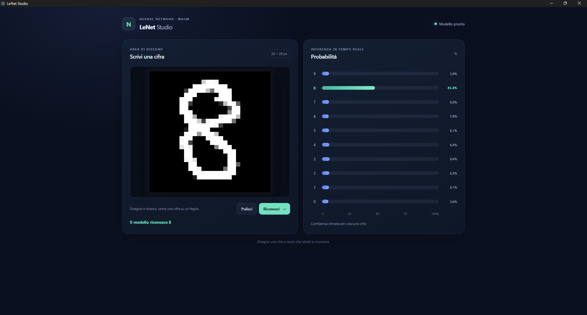
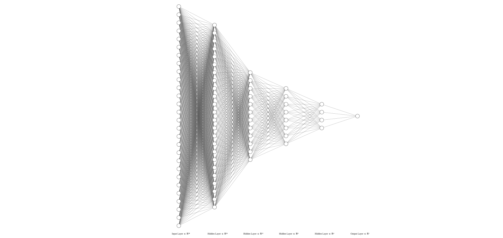
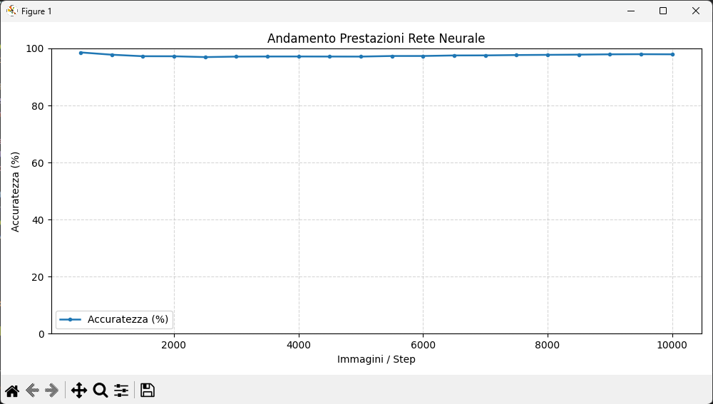
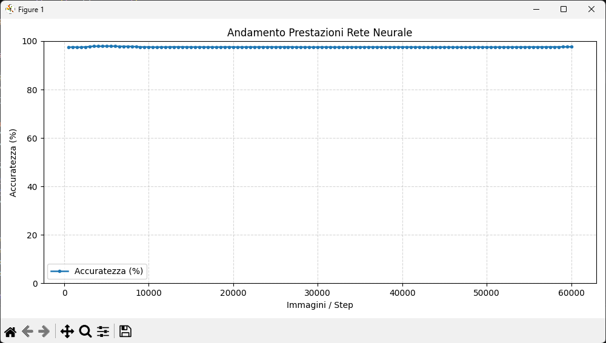

<div align="center">

# LeNet Neural Network

### Dalle convoluzioni in C++ al riconoscimento di cifre in tempo reale

Una rete neurale **ispirata a LeNet-5**, implementata in C++ senza framework di machine learning, compilata in WebAssembly e integrata in una piccola app desktop con Electron.

**C++17** · **MNIST** · **WebAssembly** · **Electron**

[Architettura](#architettura) · [Avvio rapido](#avvio-rapido) · [Come funziona](#come-funziona) · [Struttura](#struttura-del-progetto)

</div>

---

## Il progetto

Questo progetto esplora l'intero percorso di una rete neurale: operazioni sui tensori e backpropagation in C++, inferenza sui pesi salvati e una UI desktop per disegnare una cifra e vedere come il modello la classifica.



*Disegna una cifra sulla tavoletta: il modello aggiorna la previsione e le probabilità per le classi da 0 a 9.*

## Architettura

Il flusso di inferenza è:

```text
28×28 input → C1 → S2 → C3 → S4 → C5 → F6 → output (10 classi)
```



| Layer | Operazione | Dimensione in uscita |
|---|---|---:|
| Input | Immagine in scala di grigi | `1 × 28 × 28` |
| C1 | Convoluzione `5 × 5`, 6 filtri | `6 × 24 × 24` |
| S2 | Average pooling `2 × 2` | `6 × 12 × 12` |
| C3 | Convoluzione `5 × 5`, 16 filtri | `16 × 8 × 8` |
| S4 | Average pooling `2 × 2` | `16 × 4 × 4` |
| C5 | Convoluzione `4 × 4`, 120 filtri | `120 × 1 × 1` |
| F6 | Fully connected | `84` |
| Output | Fully connected, una unità per cifra | `10` |

Il progetto usa l'attivazione

```text
f(x) = 1.7159 · tanh((2/3) · x)
```

Per visualizzare i punteggi delle dieci classi, l'output viene convertito in probabilità con softmax.

## Avvio rapido

### App desktop

Per compilare il bridge C++ in WebAssembly serve **Emscripten**; per avviare l'interfaccia servono **Node.js e npm**.

1. Attiva l'ambiente Emscripten con `emsdk_env.bat` dal tuo SDK.
2. Dalla cartella principale del repository, compila il modulo:

   ```bat
   build-wasm.bat
   ```

3. Installa le dipendenze e avvia Electron:

   ```bat
   cd app
   npm install
   npm start
   ```

Lo script genera `wasm/lenet5.js`, `wasm/lenet5.wasm` e `wasm/lenet5.data`. I pesi `src/model/lenet5_weights.bin` vengono inclusi nel pacchetto di dati e caricati all'avvio.

Nell'app puoi disegnare con il mouse o il touch: l'immagine viene ritagliata, centrata e normalizzata per il modello; la previsione e le probabilità delle cifre si aggiornano mentre scrivi.

### Valutazione nativa C++

Con un compilatore C++17, dalla cartella principale:

```bat
g++ -std=c++17 -O3 -Isrc src/main.cpp -o src/build/main.exe
cd src
build\main.exe
```

Il programma legge il set MNIST di test da `data/train-test/` e carica i pesi da `src/model/lenet5_weights.bin`. Eseguilo da `src/`, perché i percorsi dei dati e dei pesi sono relativi alla directory corrente.

> **Nota:** allo stato attuale `src/main.cpp` esegue la valutazione in modalità inferenza. Il codice di backpropagation è presente, ma il flag `train` di `LayerHandler` è disattivato per impostazione predefinita: l'esecuzione di questo comando non allena la rete né aggiorna i pesi.

## Come funziona

### Convoluzione

Ogni filtro scorre sulle mappe d'ingresso, calcola una somma pesata e applica la funzione di attivazione. I layer C1, C3 e C5 imparano rispettivamente 6, 16 e 120 filtri.

### Subsampling

S2 e S4 riducono la risoluzione con average pooling `2 × 2`. Ogni area viene mediata e passata all'attivazione, riducendo il numero di valori da elaborare.

### Fully connected

Le 120 attivazioni di C5 vengono collegate a 84 neuroni nel layer F6, poi ai 10 neuroni di output, uno per ciascuna cifra.

### Pesi

I parametri della rete sono salvati in formato binario nel file `src/model/lenet5_weights.bin` e caricati sia dall'app WASM sia dal programma C++.

## Struttura del progetto

```text
.
├── app/
│   ├── main.js                 # Processo principale Electron e bridge IPC
│   └── public/                 # Interfaccia per disegnare e visualizzare i risultati
├── data/
│   ├── train/                  # Dati MNIST di training
│   └── train-test/             # Dati MNIST di test
├── img/                        # Screenshot e diagramma della rete
├── src/
│   ├── core/
│   │   ├── dataLoader.hpp      # Lettura e normalizzazione MNIST
│   │   └── layer.hpp           # Layer, inferenza e backpropagation
│   ├── model/
│   │   └── lenet5_weights.bin  # Pesi salvati
│   ├── WASM/
│   │   └── wasm_bridge.cpp     # Funzioni esportate verso WebAssembly
│   └── main.cpp                # Runner C++ per il set di test
└── build-wasm.bat              # Build Emscripten per Windows
```

## Riferimento

Architettura e funzione di attivazione prendono ispirazione dal lavoro:

> Y. LeCun, L. Bottou, Y. Bengio, P. Haffner, *Gradient-Based Learning Applied to Document Recognition*, Proceedings of the IEEE, 1998.

Il PDF è disponibile in `data/lecun-98.pdf`.

## Test di efficienza

Elaborando il dataset da 10.000 immagini di cifre manoscritte (*hand-written digits*), l'accuracy del modello si attesta intorno al **97% – 97.5%**.

<div align="center">
  
</div>

Testando invece il dataset da 60.000 immagini, l'accuracy va dal **97.5%** fino a un massimo del **97.9%**.

<div align="center">
  
</div>

| Dataset | Campioni | Accuracy |
|---|---:|---:|
| Test cifre manoscritte | `10.000` | `97.0% – 97.5%` |
| Valutazione estesa | `60.000` | `97.5% – 97.9%` |

per analisi sulle prestazioni si possono consultare i log in data/log/